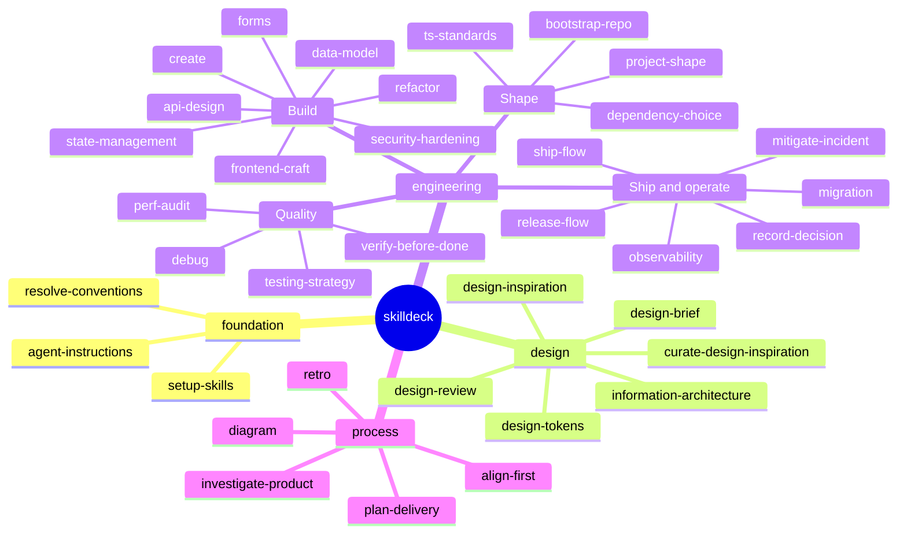

# skilldeck

36 skills for JavaScript, TypeScript, React, and React Native. They read the repo before they pick a stack.

Detect before you decide. Recommend before you impose. Ask before you assume. Prove before you claim.

| Plugin | What it is | Version |
| --- | --- | --- |
| `skilldeck` | Detects a project's conventions and defers to them. | 1.0.0 |

## Install

Pick one. A plugin install and `npx skills` together load every skill twice.

Commands for every tool are in [Install](docs/install.md). That is the page an agent should fetch.

### Native plugin

Claude Code:

```text
/plugin marketplace add jonathanjuliani/skilldeck
/plugin install skilldeck@skilldeck
```

Codex:

```bash
codex plugin marketplace add jonathanjuliani/skilldeck
codex plugin add skilldeck@skilldeck
```

Cursor: Customize → Plugins → From GitHub Repository → `https://github.com/jonathanjuliani/skilldeck`.

GitHub Copilot:

```bash
copilot plugin marketplace add jonathanjuliani/skilldeck
copilot plugin install skilldeck@skilldeck
```

Antigravity, from a clone of this repo:

```bash
agy plugin install ./plugins/skilldeck
```

Gemini CLI:

```bash
gemini extensions install https://github.com/jonathanjuliani/skilldeck
```

After a plugin install, start a new session. Setup is `/skilldeck:setup-skills`.

### Team

On Cursor Teams or Enterprise, an admin imports `https://github.com/jonathanjuliani/skilldeck` at Dashboard → Plugins → Add Marketplace → Import from Repo.

### Skills only

`npx skills` copies the skills you choose and stays unscoped. Setup is `/setup-skills`.

```bash
npx skills add jonathanjuliani/skilldeck --list
npx skills add jonathanjuliani/skilldeck
```

Devin: `npx skills add jonathanjuliani/skilldeck -a devin`.

## Update

Update the marketplace, then start a new session. Claude Code: `/plugin marketplace update skilldeck`, then `/plugin update skilldeck@skilldeck`. The other tools are in [Install](docs/install.md). A marketplace user receives a change only after a version bump.

## Release

On a clean `main`, run `python3 scripts/version.py patch` (or `minor` / `major`), then `git push --follow-tags`. The steps are in [Releasing](docs/pack/resources.md#releasing).

## Moved from `skills`

This repository was `jonathanjuliani/skills`. That URL redirects here. The old install id `skills@skilldeck` is retired. The install id is `skilldeck@skilldeck`.

## Also from skilldeck

[Skillverse](https://github.com/jonathanjuliani/skillverse) is a separate repository. Install it from there.

[adhd-focus](https://github.com/jonathanjuliani/adhd-focus) is a separate repository. Install it from there.

## The pack

<!-- skill-map:begin -->

<!-- skill-map:end -->

To share the map outside GitHub, use [skill-map.svg](docs/pack/skill-map.svg).

- **foundation** (3) — detect conventions, set up, write agent instructions
- **engineering** (22) — build, test, and ship
- **design** (6) — decide the surface before building it
- **process** (5) — align, investigate, plan, diagram, retro

One line per skill: [skills](docs/pack/skills.md).

## How a choice is made

1. **Project.** What the repo already uses. This wins.
2. **Company.** A standard the repo carries.
3. **Personal.** Your tiebreaker, only if the two above are silent.
4. **Community.** Greenfield only. Offered with a reason, confirmed first.

## Read next

- [Install](docs/install.md)
- [Contributing](CONTRIBUTING.md)
- [Skills](docs/pack/skills.md)
- [Coverage](docs/pack/coverage.md)
- [Inspirations](docs/pack/inspirations.md)
- [Resources](docs/pack/resources.md)
